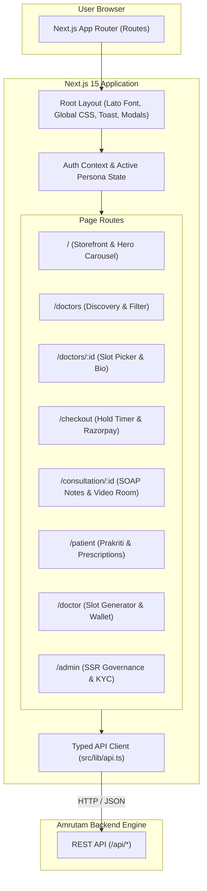
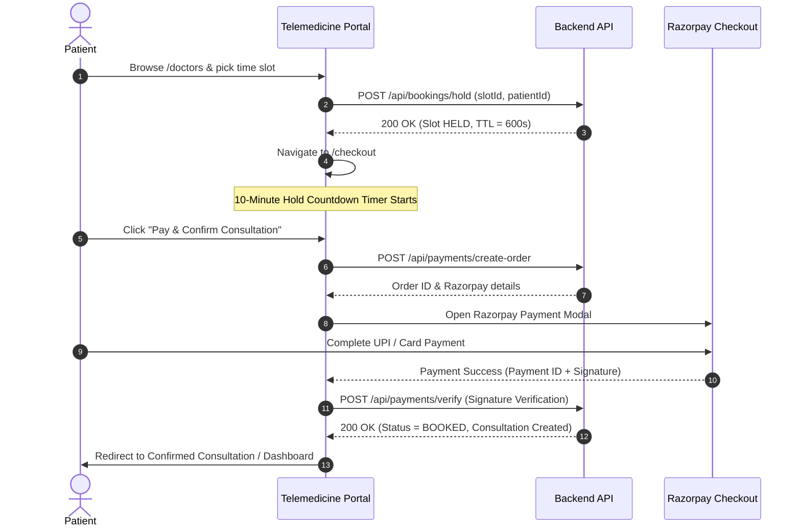

# Amrutam Telemedicine Portal - Frontend

[](https://nextjs.org/)
[](https://react.dev/)
[](https://www.typescriptlang.org/)
[]()
[]()

> High-performance, accessible, and responsive Ayurvedic Telehealth web application built with **Next.js 15 (App Router)**, **React 19**, and a **Strict Token-Driven Ayurvedic Design System**.  
> Features multi-role clinical portals for **Patients**, **Doctors**, and **Admin Governance**, complete with zero double-booking hold countdowns, Razorpay checkout, and HMAC-verified digital prescriptions.

---

## Table of Contents
1. [Ayurvedic Design Philosophy](#1-ayurvedic-design-philosophy)
2. [Frontend Architecture & Flow](#2-frontend-architecture--flow)
3. [Role-Based Portals & Key Features](#3-role-based-portals--key-features)
4. [Booking & Reservation User Journey](#4-booking--reservation-user-journey)
5. [Directory Structure](#5-directory-structure)
6. [Local Development Setup](#6-local-development-setup)
7. [Environment Variables Configuration](#7-environment-variables-configuration)
8. [Build & Verification](#8-build--verification)
9. [Production Deployment on Render](#9-production-deployment-on-render)

---

## 1. Ayurvedic Design Philosophy

The interface follows the handcrafted **Amrutam Design System**, reflecting herbal harmony, authenticity, and clinical trust:

- **Warm Cream Canvas (`#fffdf3`)**: Pure white (`#ffffff`) is strictly avoided on page backgrounds to maintain a warm, organic herbal aesthetic.
- **Deep Forest Green (`#213d31`)**: Used for high-contrast primary text, brand logo headers, and dark surfaces.
- **Earthy Moss Green (`#3a643b`)**: Used for primary interactive actions, badges, and herbal accents.
- **Pale Sage Tint (`#f7fbf5`)**: Soft background for clinical cards, panels, and input surfaces.
- **Lato Typography**: Strict font hierarchy (weights 300, 400, 700, 900) across all headings, body text, and tabular clinical data.
- **Accessibility (WCAG 2.2 AA)**: Explicit `:focus-visible` outlines, high-contrast text ratios, and keyboard-navigable slot selection.

---

## 2. Frontend Architecture & Flow



---

## 3. Role-Based Portals & Key Features

### 3.1 Patient Portal (`/patient`)
- **Prakriti Assessment**: Displays the patient's Ayurvedic constitution (`VATA_PITTA`, `PITTA_KAPHA`, `TRIDOSHIC`).
- **Consultation History**: Chronological timeline of completed and scheduled clinical consultations.
- **Digital Prescriptions**: View Ayurvedic herbal formulations with real-time **HMAC-SHA256 signature verification badges**.
- **Profile Management**: Update contact details, emergency contacts, and registered health parameters.

### 3.2 Doctor Portal (`/doctor`)
- **KYC Verification Status**: Real-time badge indicating whether the doctor's medical license is `VERIFIED`, `PENDING_VERIFICATION`, or `REJECTED`.
- **Bulk Slot Generator**: Single-click automated generation of 28+ consultation slots spanning the next 7 days.
- **Custom Slot Publisher**: Create individual audio, video, or chat consultation slots with custom consultation fees.
- **Clinical Earnings Wallet**: Real-time earnings summary, pending settlements, and payout withdrawal requests.

### 3.3 Admin Governance Center (`/admin` - Server-Side Rendered)
- **Clinical KPIs**: System-wide statistics on total patients, verified doctors, gross revenue, and prevented double-booking conflicts.
- **Doctor KYC Management**: Review submitted medical licenses and approve or reject doctor registrations with recorded feedback.
- **Payout Settlement Processing**: Approve or reject doctor wallet payout requests.
- **Cryptographic Audit Ledger Verification**: Validate the cryptographic hash chain of all system events to prove tamper resistance.

---

## 4. Booking & Reservation User Journey



---

## 5. Directory Structure

```
frontend/
├── public/
│   └── images/
│       ├── logo/              # Official Amrutam brand logo (logo.jpeg)
│       └── hero/              # High-resolution Ayurvedic hero carousel images
├── src/
│   ├── app/                   # Next.js 15 App Router pages & server components
│   │   ├── admin/             # Admin Governance Dashboard (SSR + Client)
│   │   ├── checkout/          # 10-minute hold checkout & Razorpay payment
│   │   ├── consultation/      # Consultation room & clinical notes
│   │   ├── doctor/            # Doctor dashboard & slot generation
│   │   │   └── register/      # New doctor license registration form
│   │   ├── doctors/           # Doctor directory & profile views
│   │   ├── patient/           # Patient dashboard, Prakriti & prescriptions
│   │   ├── prescriptions/     # Digital prescription detail & HMAC badge
│   │   ├── layout.tsx         # Root layout with fonts & providers
│   │   └── page.tsx           # Storefront landing page & hero carousel
│   ├── components/            # Reusable UI component library
│   │   ├── booking/           # SlotPicker, HoldCountdownTimer
│   │   ├── doctors/           # DoctorCard, SpecialtyFilter
│   │   ├── home/              # HeroCarousel, TrustBar, HowItWorks
│   │   ├── layout/            # Header, Footer, AuthModal, AppProviders
│   │   ├── prescription/      # PrescriptionTable, HMACBadge
│   │   └── ui/                # Button, Badge, Modal, Input, Card
│   ├── lib/                   # Utilities & state management
│   │   ├── api.ts             # Typed API client with auto-sanitized URLs
│   │   └── auth-context.tsx   # AuthProvider, Persona Switcher & Session Teardown
│   ├── styles/                # Strict Amrutam design tokens
│   │   ├── tokens.css         # Color palettes, typography, spacing, shadows
│   │   └── globals.css        # Reset, focus rings, utility classes
│   └── types/                 # Shared TypeScript domain interfaces
├── Dockerfile                 # Multi-stage Next.js standalone container
├── next.config.mjs            # Next.js configuration
├── package.json               # Dependencies & scripts
└── tsconfig.json              # TypeScript configuration
```

---

## 6. Local Development Setup

### Prerequisites
- **Node.js**: `v20.x` or `v22.x` (LTS recommended)
- **npm**: `v10.x` or higher
- **Backend API**: The [Amrutam Telemedicine Backend](https://github.com/creativecoder99/Amrutam-telemedicine-backend) should ideally be running at `http://localhost:4000/api`.

### Step-by-Step Installation

1. **Clone the repository**:
   ```bash
   git clone https://github.com/creativecoder99/Amrutam-telemedicine-frontend.git
   cd Amrutam-telemedicine-frontend
   ```

2. **Install dependencies**:
   ```bash
   npm install
   ```

3. **Configure Environment Variables**:
   Copy the provided `.env.example` file to `.env.local`:
   ```bash
   cp .env.example .env.local
   ```
   *(Review and configure values in `.env.local` as described in Section 7).*

4. **Start the Next.js Development Server**:
   ```bash
   npm run dev
   ```
   The application will be live at: `http://localhost:3000`

---

## 7. Environment Variables Configuration

> **CRITICAL SECURITY NOTICE**: Never commit your `.env.local` file or actual API secrets to version control. The values below are sanitized template examples.

| Variable | Required | Default / Example Value | Description |
| :--- | :--- | :--- | :--- |
| `NEXT_PUBLIC_API_URL` | **Required** | `http://localhost:4000/api` | Base URL of the Amrutam backend API. Can point to local (`http://localhost:4000/api`) or production (`https://your-backend.onrender.com/api`). |
| `NEXT_PUBLIC_RAZORPAY_KEY_ID` | Optional | `rzp_test_your_razorpay_key` | Razorpay public key ID used to open the client-side Razorpay checkout modal. |

---

## 8. Build & Verification

To verify that all Next.js pages compile cleanly with zero TypeScript errors:

```bash
# Production build
npm run build

# Start production server
npm run start

# Code linting
npm run lint
```

When building, all 11 routes (including static routes and dynamic SSR `/admin`) are validated and bundled into optimized production chunks.

---

## 9. Production Deployment on Render

Because this Next.js application uses **Server-Side Rendering (SSR)** for the `/admin` clinical governance center, it must be deployed as a **Web Service** (not a Static Site):

1. **Create Web Service** on [Render.com](https://render.com) and link repository `Amrutam-telemedicine-frontend`.
2. **Configure Service Settings**:
   - **Environment**: `Node`
   - **Build Command**: `npm install && npm run build`
   - **Start Command**: `npm run start`
   - **Auto-Deploy**: `Yes` (Branch: `main`)
3. **Set Environment Variables in Render Dashboard**:
   - `NEXT_PUBLIC_API_URL`: `https://your-backend-service.onrender.com/api`
   - `NEXT_PUBLIC_RAZORPAY_KEY_ID`: `rzp_test_your_key` *(or live key in production)*
   - `NODE_ENV`: `production`

---

## License
Proprietary & Confidential. Copyright © 2026 Amrutam Pharmaceuticals & Telehealth Pvt. Ltd. All rights reserved.
