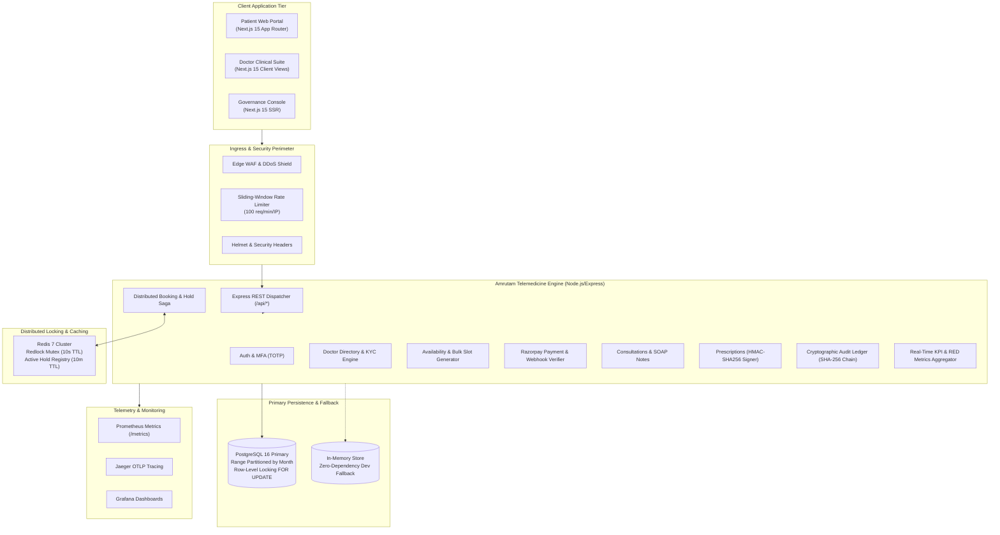
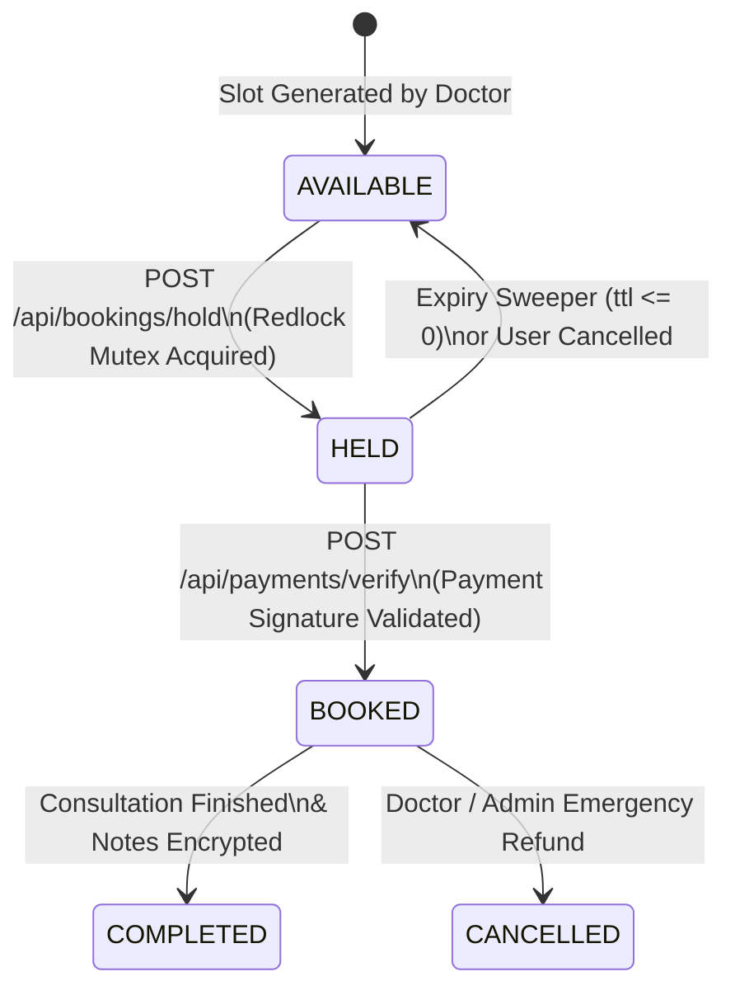
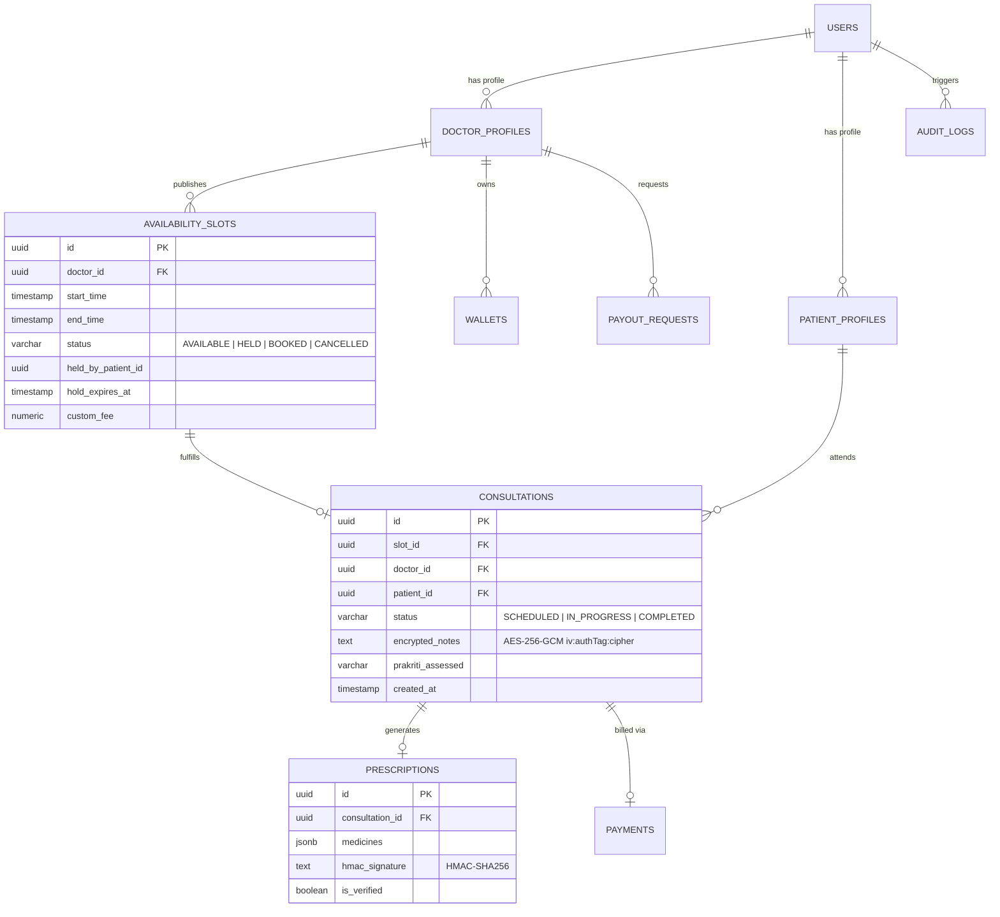
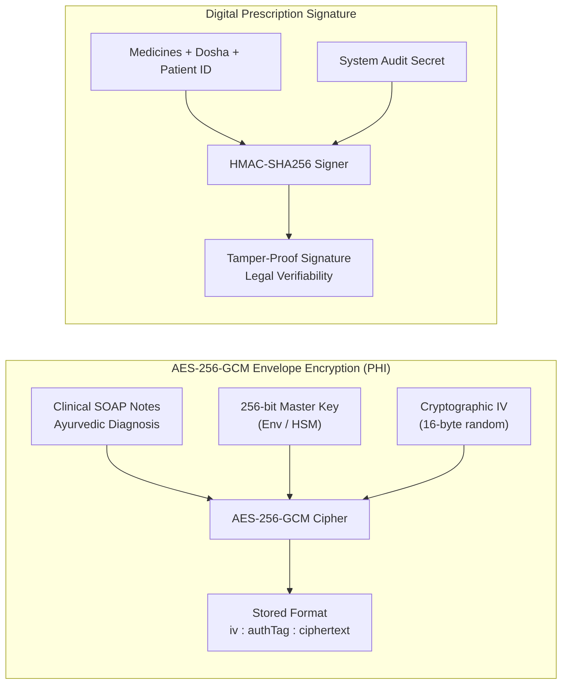

# Amrutam Telemedicine System — System Architecture Document

| Document Metadata | Details |
| :--- | :--- |
| **System** | Amrutam Clinical Telemedicine Engine & Patient Portal |
| **Document Version** | 2.0.0 (Production Architecture Specification) |
| **Target Scale** | 100,000 daily consultations (Peak ~2,000 req/sec) |
| **Primary Stack** | Next.js 15, React 19, TypeScript 5.7, Express 4, PostgreSQL 16, Redis 7 |
| **Compliance** | DISHA (India), ABDM (M1/M2/M3), HIPAA, DPDP Act 2023 |

---

## 1. Executive Summary & Design Principles

The Amrutam Telemedicine System is an enterprise-grade digital health engine engineered to deliver authentic Ayurvedic clinical consultations at national scale. The architecture resolves the fundamental challenge of healthcare scheduling: **eliminating double-booking collisions under high concurrent load**, while enforcing **strict clinical confidentiality via AES-256-GCM envelope encryption** and **tamper-evident digital prescription issuance**.

### Core Architecture Tenets
1. **Zero Double-Booking Concurrency Invariant**: No two patients can ever hold or book the same doctor's slot, enforced via a multi-tier distributed mutex lock and transactional database state transitions.
2. **Cryptographic Integrity & Non-Repudiation**: Every clinical prescription is signed using an HMAC-SHA256 signature, and every PHI access is written to an immutable cryptographic hash chain.
3. **Resilience & Dual-Mode Persistence**: The engine connects to clustered PostgreSQL 16 and Redis 7 in production, while maintaining an autonomous in-memory store with transactional fallbacks for zero-dependency local testing.
4. **Strict Token-Driven Ayurvedic UI**: Accessible, warm-toned frontend honoring traditional Ayurvedic aesthetics (Warm Cream `#fffdf3`, Forest Green `#213d31`, Earthy Moss `#3a643b`, Lato typography).

---

## 2. High-Level Component Topology



---

## 3. Concurrency & Zero Double-Booking Architecture

### 3.1 The Race Condition Problem
Under peak load (e.g., morning slot releases), thousands of patients may attempt to book the same high-demand Vaidya (doctor) within milliseconds. A conventional read-then-write database approach (`SELECT status ... UPDATE status = 'BOOKED'`) creates classic race conditions leading to devastating double-bookings.

### 3.2 Two-Tier Reservation Lifecycle
To guarantee absolute concurrency safety across distributed nodes, Amrutam implements a multi-tier reservation protocol:



### 3.3 Mutex Lock & Temporary Hold Mechanics
1. **Phase 1: Redis Redlock Distributed Mutex**:
   - The booking engine issues a distributed lock request: `SET lock:slot:{slotId} {token} NX PX 10000` (10-second lock window).
   - Only the first concurrent request acquires the mutex; all other concurrent requests immediately fail with `409 Conflict: Slot is currently locked by another transaction`.
2. **Phase 2: Database State Transition to `HELD`**:
   - Inside the mutex-protected critical section, the slot is verified to have `status = 'AVAILABLE'`.
   - The slot is transitioned to `status = 'HELD'`, stamped with `heldByPatientId` and an expiration timestamp: `holdExpiresAt = NOW() + 10 MINUTES`.
3. **Phase 3: Checkout Window (600s TTL)**:
   - The patient is redirected to `/checkout`. A live countdown timer monitors the 10-minute reservation window.
   - Other users viewing the slot see `HELD (Unavailable)`.
4. **Phase 4: Payment Verification & Commitment**:
   - When Razorpay returns payment authorization, the signature is validated via HMAC-SHA256 (`crypto.createHmac('sha256', secret)`).
   - The slot transitions atomically from `HELD` to `BOOKED`.
5. **Phase 5: Auto-Expiry Sweeper**:
   - If payment is not completed before `holdExpiresAt`, the background worker resets the slot to `AVAILABLE` and clears `heldByPatientId`.

---

## 4. Data Architecture & Relational Entity Model



### Table Partitioning Strategy
To maintain sub-50ms query times over years of clinical operations, `consultations` and `availability_slots` are range-partitioned by month:
```sql
CREATE TABLE consultations (
    id UUID NOT NULL,
    consultation_date DATE NOT NULL,
    doctor_id UUID NOT NULL,
    patient_id UUID NOT NULL,
    status VARCHAR(32) NOT NULL,
    encrypted_notes TEXT,
    created_at TIMESTAMPTZ DEFAULT NOW(),
    PRIMARY KEY (id, consultation_date)
) PARTITION BY RANGE (consultation_date);
```

---

## 5. Security & Cryptographic Architecture



### 5.1 Tamper-Evident Audit Hash Chain
Every sensitive PHI read, prescription write, or payout approval appends an immutable block to the audit ledger:
$$\text{Hash}_n = \text{SHA-256}(\text{Sequence}_n \parallel \text{Timestamp}_n \parallel \text{ActorId}_n \parallel \text{Action}_n \parallel \text{Payload}_n \parallel \text{Hash}_{n-1})$$

The endpoint `GET /api/audit/verify-chain` verifies every link from genesis block to current head. Any manual alteration in database rows instantly breaks the mathematical chain.

---

## 6. Resilience & In-Memory Fallback Engine

Amrutam implements a **Dual-Mode Persistence Architecture**:
- In production, all queries execute against clustered PostgreSQL 16 and Redis 7.
- During local development, automated test execution, or infrastructure failover, the `dbStore` (`src/database/store.ts`) detects connection status and automatically switches to an in-memory transactional mock engine.
- This ensures zero-dependency local runs and 100% test reproducibility without requiring a running database daemon.

---

## 7. Observability & Telemetry Topology

- **RED Metrics**: Standardized Prometheus metrics (`http_request_duration_seconds`, `slot_hold_attempts_total`, `double_booking_conflicts_prevented_total`, `active_slot_holds_count`).
- **Distributed Tracing**: Jaeger OpenTelemetry instrumentation tracing requests from ingress to database execution.
- **Log Correlation**: Pino structured JSON logger tagging every log line with `correlationId` passed via `X-Correlation-ID`.
- **Health Probes**: Multi-tier health endpoints for container orchestrators:
  - `/health/live`: Liveness check (process responds).
  - `/health/ready`: Readiness check (database & Redis connectivity validated).
  - `/health/startup`: Startup probe (initialization duration).

---

## 8. Deployment Topology

The entire ecosystem is orchestrated via Docker Compose for local/staging environments and modular Web Services for cloud deployment:

| Service | Technology | Port | Role |
| :--- | :--- | :--- | :--- |
| **Frontend** | Next.js 15 Standalone | `3000` | Patient Storefront & Clinical Suite |
| **Backend** | Node.js Express Engine | `4000` | Concurrency & Telehealth REST Core |
| **PostgreSQL** | PostgreSQL 16 Alpine | `5432` | Partitioned Relational Database |
| **Redis** | Redis 7 Alpine | `6379` | Distributed Mutex & Rate Limiter |
| **Prometheus**| Prometheus Latest | `9090` | Telemetry & Metrics Scraper |
| **Jaeger** | Jaeger All-in-One | `16686`| Distributed Tracing UI & OTLP |
| **Grafana** | Grafana Latest | `3001` | Operations & Clinical KPI Dashboards |
