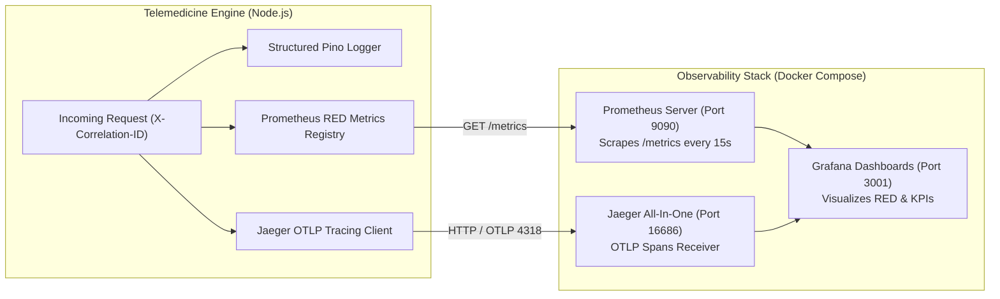

# Amrutam Telemedicine System — Observability & Telemetry Runbook

| Metadata | Description |
| :--- | :--- |
| **System** | Amrutam Clinical Telemedicine Engine |
| **Document Version** | 1.0.0 (Production Observability Specification) |
| **Telemetry Stack** | Prometheus 2.50+, Grafana 10+, Jaeger Tracing (OTLP), Pino JSON Logging |

---

## 1. Observability Architecture Overview

The Amrutam Telemedicine System implements the **Three Pillars of Observability** (Metrics, Logs, and Traces) engineered specifically for mission-critical healthcare operations:



---

## 2. Metrics Catalog (Prometheus)

All application metrics are exposed in standard Prometheus exposition text format at:
```http
GET /metrics
```

### 2.1 RED Method (Rate, Errors, Duration)
- **`http_request_duration_seconds`** (Histogram): Tracks request latency across all endpoints with buckets `[0.005, 0.01, 0.025, 0.05, 0.1, 0.25, 0.5, 1, 2.5, 5, 10]`.
  - **Labels**: `method` (GET, POST, etc.), `route` (`/api/bookings/hold`, `/api/doctors`, etc.), `status_code` (`200`, `201`, `409`, `500`).

### 2.2 Concurrency & Domain Metrics
- **`double_booking_conflicts_prevented_total`** (Counter): Monotonically increasing counter incremented every time a concurrent race condition is intercepted and prevented by the Redis Redlock mutex or database state check.
- **`slot_hold_attempts_total`** (Counter): Tracks patient reservation attempts labeled by status:
  - `status="attempt"`: Total hold requests initiated.
  - `status="lock_conflict"`: Mutex acquisition failed (slot being locked by another concurrent patient).
  - `status="already_taken"`: Slot is already held or booked.
  - `status="held_success"`: Slot successfully reserved for 10 minutes.
- **`active_slot_holds_count`** (Gauge): Real-time gauge of currently active 10-minute temporary holds pending checkout completion.

---

## 3. Prometheus Scrape Configuration

The Prometheus server configuration is defined in [`infra/observability/prometheus.yml`](file:///c:/Users/anura/OneDrive/Desktop/projects/Amrutam%20teleMedicine%20System/infra/observability/prometheus.yml):

```yaml
global:
  scrape_interval: 15s
  evaluation_interval: 15s

scrape_configs:
  - job_name: 'amrutam-telemedicine-backend'
    scrape_interval: 5s
    metrics_path: '/metrics'
    static_configs:
      - targets: ['backend:4000']
        labels:
          environment: 'production'
          service: 'telemedicine-engine'
```

---

## 4. Distributed Tracing (Jaeger & OpenTelemetry)

To diagnose latency across distributed microservices, database queries, and Redis mutex acquisitions, the system integrates with Jaeger:
- **Jaeger UI**: `http://localhost:16686`
- **OTLP Receiver**: `http://localhost:4318`
- **Trace Context Propagation**: Passes standard W3C `traceparent` headers through reverse proxies and upstream services.

---

## 5. Structured JSON Logging & Request Correlation

All log output is rendered as structured JSON via **Pino** for ingestion into ELK / Grafana Loki:

```json
{
  "level": 30,
  "time": "2026-10-28T12:00:00.123Z",
  "pid": 1,
  "hostname": "amrutam_backend",
  "correlationId": "c4b96f12-08f3-424a-b5ea-5f348e3e4a28",
  "method": "POST",
  "url": "/api/bookings/hold",
  "slotId": "slot-12345",
  "patientId": "patient-67890",
  "msg": "Acquiring distributed Redlock mutex for slot hold"
}
```

### Correlation ID Middleware
Every request is stamped with a unique correlation identifier:
1. If the client passes an `X-Correlation-ID` header, it is adopted.
2. Otherwise, a cryptographically random UUIDv4 is generated and attached to response headers (`X-Correlation-ID`).

---

## 6. Health Check Probes (Kubernetes & Docker)

| Probe | Endpoint | Expected Status | Purpose |
| :--- | :--- | :--- | :--- |
| **Liveness** | `GET /health/live` | `200 OK` | Confirms the Node.js event loop is responding. |
| **Readiness**| `GET /health/ready`| `200 OK` | Verifies active connections to PostgreSQL and Redis. |
| **Startup**  | `GET /health/startup` | `200 OK` | Reports process uptime and initialization state. |

---

## 7. Grafana Dashboard Runbook

When running the master stack via Docker Compose:
1. Navigate to: `http://localhost:3001`
2. Login credentials: `admin` / `admin`
3. Pre-configured dashboards:
   - **RED Golden Signals**: Requests per second (RPS), p95 / p99 latency heatmaps, HTTP 4xx / 5xx error percentages.
   - **Clinical Concurrency Dashboard**: Active slot holds gauge, hold conversion rate, double-booking collisions intercepted.
   - **Doctor Operations & Settlements**: Daily completed consultations, gross revenue settled, pending payouts.
