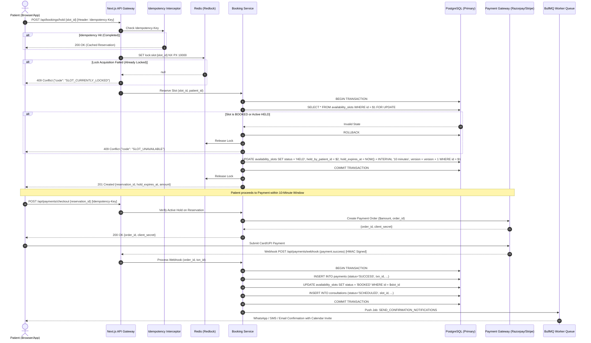
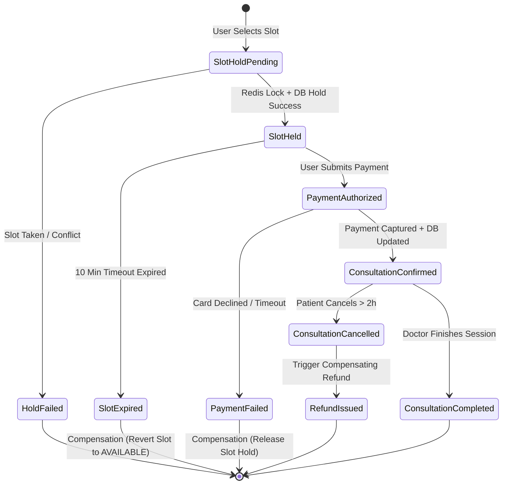

# Amrutam Telemedicine System — Technical Requirements Document (TRD)

| **Document Version** | 1.0.0 |
| **Status**           | Approved for Engineering |
| **Target Scale**     | 100,000 daily consultations (Peak ~2,000 req/sec) |
| **Primary Stack**    | Next.js 15, Node.js (TypeScript), PostgreSQL 16, Redis 7, BullMQ |

---

## 1. System Overview & Technology Stack

The Amrutam Telemedicine backend is engineered as a modular, high-throughput, fault-tolerant system built on **Next.js 15** and **Node.js** with **TypeScript** in strict mode. The architecture combines the ergonomics of Next.js for unified API routing and SSR/Edge rendering with decoupled, dependency-injected Node.js domain services, worker pools, and caching layers.

```
+-----------------------------------------------------------------------------------------+
|                                    Client Layer                                         |
|                 (Next.js Web App, Mobile App, Partner API Clients)                     |
+-----------------------------------------------------------------------------------------+
                                             |
                                     TLS 1.3 / HTTPS
                                             v
+-----------------------------------------------------------------------------------------+
|                                API Gateway & Edge Layer                                 |
|         Reverse Proxy (Nginx/Envoy) | Cloudflare WAF | DDoS & Rate Limiting            |
+-----------------------------------------------------------------------------------------+
                                             |
                                             v
+-----------------------------------------------------------------------------------------+
|                             Next.js 15 / Node.js API Service                            |
|  - Rate Limiter Middleware (Redis Token Bucket)                                         |
|  - Idempotency Middleware (Idempotency-Key Header + Redis 2-Phase Cache)                |
|  - Auth & RBAC Middleware (JWT Validation + TOTP MFA Verification)                      |
|  - Request Validation & Sanitation (Zod Schemas)                                        |
|  - Audit Log Interceptor (HMAC Tamper-Proof Chain)                                      |
+-----------------------------------------------------------------------------------------+
        |                     |                       |                     |
        v                     v                       v                     v
+---------------+     +---------------+       +---------------+     +-------------------+
|  Auth & IAM   |     |  Doctor &     |       |  Booking &    |     |  Prescriptions &  |
|  Service      |     |  Slots Engine |       |  Saga Manager |     |  Consultations    |
+---------------+     +---------------+       +---------------+     +-------------------+
        |                     |                       |                     |
        +---------------------+-----------------------+---------------------+
                                  |
                                  v
+-----------------------------------------------------------------------------------------+
|                                  Infrastructure Layer                                   |
|  +---------------------------+   +-----------------------+   +-----------------------+  |
|  |     Redis 7 Cluster       |   | PostgreSQL 16 Primary |   | BullMQ Worker Pool    |  |
|  | - Redlock Distributed Lock|   | - Declarative Partit. |   | - Email/SMS Alerts    |  |
|  | - Session & Token Cache   |   | - Row-level Locking   |   | - Prescription PDF Gen|  |
|  | - Doctor Search Index L2  |   | - AES-256 Encrypted   |   | - Reminder Scheduler  |  |
|  +---------------------------+   +-----------------------+   +-----------------------+  |
|                                              |                                          |
|                                              v Read Replica                             |
|                                  +-----------------------+                              |
|                                  | PostgreSQL 16 Replica |                              |
|                                  | - Read Queries (p95)  |                              |
|                                  +-----------------------+                              |
+-----------------------------------------------------------------------------------------+
```

---

## 2. Capacity Planning & Quantitative Sizing (100k Consultations/Day)

### 2.1 Traffic & Requests Per Second (RPS)
* **Daily Target**: 100,000 completed consultations.
* **Peak Ratio**: Medical consultation bookings follow an 80/20 power law distribution across a 12-hour window (08:00 to 20:00).
  $$\text{Effective Operating Window} = 12 \text{ hours} = 43,200 \text{ seconds}$$
  $$\text{Average Consultation Booking Writes/sec} = \frac{100,000}{43,200} \approx 2.31 \text{ writes/sec}$$
  $$\text{Peak Multiplier (Burst)} = 10\times \implies \mathbf{\approx 25 \text{ booking writes/sec}}$$
* **Ancillary Writes**: Status updates, notes, vitals, prescriptions, audit trails, and payments trigger $\approx 8\times$ writes per consultation:
  $$\text{Peak Transactional Writes/sec} = 25 \times 8 = \mathbf{200 \text{ writes/sec}}$$
* **Read-to-Write Ratio**: In healthcare search and discovery, the read-to-write ratio is conservatively $10:1$ to $15:1$:
  $$\text{Peak Read RPS} = 200 \times 10 = \mathbf{2,000 \text{ reads/sec}}$$
* **Total Peak API RPS**: $\approx 2,200 \text{ req/sec}$.

### 2.2 Storage & Network Capacity Growth
* Average Consultation Record Footprint:
  * Consultation row + metadata: $\approx 2 \text{ KB}$
  * Prescription (line items + diagnosis): $\approx 4 \text{ KB}$
  * Audit logs ($6\times$ events per consultation): $6 \times 1.5 \text{ KB} = 9 \text{ KB}$
  * Total database storage per consultation: $\mathbf{\approx 15 \text{ KB}}$
* **Daily Storage Ingestion**:
  $$100,000 \times 15 \text{ KB} = 1.5 \text{ GB / day} \implies \mathbf{\approx 45 \text{ GB / month}} \implies \mathbf{\approx 540 \text{ GB / year}}$$
* **PDF Artifacts (Prescriptions & Invoices)**:
  * Compressed PDF stored in S3/Blob: $\approx 150 \text{ KB}$ each
  * Daily S3 storage: $100,000 \times 150 \text{ KB} = 15 \text{ GB / day} \implies \mathbf{\approx 450 \text{ GB / month}}$

### 2.3 Latency Budgets & SLA
* **Read SLA**: p95 $< 200\text{ms}$, p99 $< 400\text{ms}$ (Doctor search, slot queries, profiles).
* **Write SLA**: p95 $< 500\text{ms}$, p99 $< 1,000\text{ms}$ (Slot reservation hold, checkout, prescription finalization).
* **Availability**: 99.95% ($\le 21.6 \text{ minutes of downtime per month}$).

---

## 3. Data Model & Entity Relationship (ER) Architecture

### 3.1 ER Diagram (Mermaid)

```mermaid
erDiagram
    USERS ||--o{ DOCTORS : "promoted to"
    USERS ||--o{ USER_PROFILES : "has"
    USERS ||--o{ CONSULTATIONS : "participates as patient"
    DOCTORS ||--o{ AVAILABILITY_SLOTS : "publishes"
    DOCTORS ||--o{ CONSULTATIONS : "conducts as doctor"
    AVAILABILITY_SLOTS ||--o| CONSULTATIONS : "booked for"
    CONSULTATIONS ||--o| PRESCRIPTIONS : "generates"
    PRESCRIPTIONS ||--o{ PRESCRIPTION_ITEMS : "contains"
    CONSULTATIONS ||--o{ PAYMENTS : "billed via"
    USERS ||--o{ AUDIT_LOGS : "triggers"
    IDEMPOTENCY_KEYS ||--o| PAYMENTS : "guards"

    USERS {
        uuid id PK
        string email UK
        string phone UK
        string password_hash
        string role "PATIENT|DOCTOR|ADMIN|AUDITOR"
        boolean is_mfa_enabled
        string mfa_secret_encrypted
        string status "ACTIVE|SUSPENDED|PENDING_VERIFICATION"
        timestamp created_at
        timestamp updated_at
    }

    USER_PROFILES {
        uuid id PK
        uuid user_id FK, UK
        string first_name
        string last_name
        date date_of_birth
        string gender
        string blood_group
        string prakriti_type "VATA|PITTA|KAPHA|VATA_PITTA|..."
        text medical_history_encrypted
        text allergies_encrypted
        timestamp created_at
        timestamp updated_at
    }

    DOCTORS {
        uuid id PK
        uuid user_id FK, UK
        string license_number UK
        string specialization
        int experience_years
        decimal consultation_fee
        decimal rating_avg
        int total_reviews
        string verification_status "PENDING|VERIFIED|REJECTED"
        text bio
        jsonb languages
        timestamp created_at
        timestamp updated_at
    }

    AVAILABILITY_SLOTS {
        uuid id PK
        uuid doctor_id FK
        timestamp start_time
        timestamp end_time
        string status "AVAILABLE|HELD|BOOKED|CANCELLED"
        uuid held_by_patient_id
        timestamp hold_expires_at
        int version "Optimistic Locking"
        timestamp created_at
    }

    CONSULTATIONS {
        uuid id PK
        string consultation_number UK
        uuid patient_id FK
        uuid doctor_id FK
        uuid slot_id FK, UK
        string status "SCHEDULED|WAITING_ROOM|IN_PROGRESS|COMPLETED|CANCELLED|NO_SHOW"
        timestamp scheduled_start_time
        timestamp scheduled_end_time
        timestamp actual_start_time
        timestamp actual_end_time
        text encrypted_soap_notes
        text encrypted_diagnosis
        string cancellation_reason
        timestamp created_at
        timestamp updated_at
    }

    PRESCRIPTIONS {
        uuid id PK
        string prescription_number UK
        uuid consultation_id FK, UK
        uuid doctor_id FK
        uuid patient_id FK
        text encrypted_clinical_summary
        string status "DRAFT|FINALIZED|REVOKED"
        string digital_signature_hash
        string pdf_storage_url
        timestamp signed_at
        timestamp created_at
    }

    PRESCRIPTION_ITEMS {
        uuid id PK
        uuid prescription_id FK
        string medicine_name
        string formulation_type "TABLET|SYRUP|CHURNA|TAILA|KWATH"
        string dosage
        string frequency "ONCE_DAILY|TWICE_DAILY|THRICE_DAILY|AS_NEEDED"
        string anupana "WARM_WATER|HONEY|MILK|GHEE|NONE"
        int duration_days
        text instructions
    }

    PAYMENTS {
        uuid id PK
        uuid consultation_id FK
        uuid patient_id FK
        string idempotency_key UK
        string transaction_reference UK
        decimal amount
        string currency
        string payment_gateway "RAZORPAY|STRIPE|MOCK"
        string status "PENDING|SUCCESS|FAILED|REFUNDED"
        jsonb gateway_payload
        timestamp created_at
        timestamp updated_at
    DOCTORS ||--o| WALLETS : "owns"
    DOCTORS ||--o{ PAYOUT_REQUESTS : "requests"

    WALLETS {
        uuid id PK
        uuid doctor_id FK, UK
        decimal balance "Current available withdrawal balance"
        decimal total_earned "Cumulative historical earnings"
        timestamp updated_at
    }

    PAYOUT_REQUESTS {
        uuid id PK
        uuid doctor_id FK
        decimal amount "Min threshold 1000 INR"
        string status "PENDING|PROCESSED|REJECTED"
        jsonb account_details "UPI ID / IFSC & Account Number"
        timestamp requested_at
        timestamp processed_at
        text admin_notes
    }

    AUDIT_LOGS {
        bigserial id PK
        uuid user_id
        string user_role
        string action
        string resource_type
        uuid resource_id
        string ip_address
        string user_agent
        string payload_hash
        string previous_record_hash
        timestamp created_at
    }

    IDEMPOTENCY_KEYS {
        string key PK
        uuid user_id
        string request_hash
        string status "PENDING|COMPLETED|FAILED"
        int response_status_code
        jsonb response_body
        timestamp expires_at
        timestamp created_at
    }
```

---

## 4. Concurrency Handling & Zero Double-Booking Architecture

### 4.1 The Race Condition Threat
When 50 patients attempt to book the same prime doctor slot at 09:00 AM, traditional naive read-then-write logic results in phantom reads and multiple bookings.

```
Patient 1: SELECT status FROM availability_slots WHERE id = 'X'; -- (returns AVAILABLE)
Patient 2: SELECT status FROM availability_slots WHERE id = 'X'; -- (returns AVAILABLE)
Patient 1: UPDATE availability_slots SET status = 'BOOKED' WHERE id = 'X';
Patient 2: UPDATE availability_slots SET status = 'BOOKED' WHERE id = 'X';
Result: Double booking disaster.
```

### 4.2 Multi-Tier Defense-in-Depth Solution
We enforce concurrency control across three distinct layers:

```
+-------------------------------------------------------------------------+
| Layer 1: Distributed Lock (Redis Redlock / SET NX PX)                  |
| - Key: `lock:slot:{slot_id}`, TTL: 10,000ms                             |
| - Fail fast: Returns 409 Conflict within 15ms if lock already acquired  |
+-------------------------------------------------------------------------+
                                    | Lock Acquired
                                    v
+-------------------------------------------------------------------------+
| Layer 2: Relational Row-Level Lock & Hold State (PostgreSQL)            |
| - `SELECT id, status, version FROM availability_slots ... FOR UPDATE`   |
| - Verify status == 'AVAILABLE' OR (status == 'HELD' AND expires < now())|
| - Transition status to 'HELD', set `hold_expires_at = now() + 10 mins`  |
+-------------------------------------------------------------------------+
                                    | Held Successfully
                                    v
+-------------------------------------------------------------------------+
| Layer 3: Database Declarative Constraints                               |
| - Unique partial index: `UNIQUE (doctor_id, start_time)`                |
| - Check constraint: `CHECK (end_time > start_time)`                     |
| - Foreign Key unique constraint: `consultations.slot_id UNIQUE`         |
+-------------------------------------------------------------------------+
```

### 4.3 Redis Lock Implementation Contract
```typescript
async function acquireSlotReservationLock(slotId: string, ttlMs = 10000): Promise<string | null> {
  const lockToken = crypto.randomUUID();
  const key = `lock:slot:${slotId}`;
  // SET key token NX PX ttlMs
  const acquired = await redisClient.set(key, lockToken, 'PX', ttlMs, 'NX');
  return acquired === 'OK' ? lockToken : null;
}

async function releaseSlotReservationLock(slotId: string, token: string): Promise<boolean> {
  const key = `lock:slot:${slotId}`;
  // Atomic Lua script ensures we only delete our own lock
  const luaScript = `
    if redis.call("get", KEYS[1]) == ARGV[1] then
      return redis.call("del", KEYS[1])
    else
      return 0
    end
  `;
  const result = await redisClient.eval(luaScript, 1, key, token);
  return result === 1;
}
```

---

## 5. End-to-End Booking Sequence Diagram (Mermaid)



---

## 6. Distributed Saga Orchestration for Consultations & Payments

When booking a consultation, multiple distributed resources are coordinated:
1. Slot State Machine (`AVAILABLE` $\to$ `HELD` $\to$ `BOOKED`)
2. Payment Gateway (`AUTHORIZE` $\to$ `CAPTURE`)
3. Consultation State (`SCHEDULED`)
4. Notification & Calendar Queue

We employ an **Orchestrated Saga** state machine to ensure absolute eventual consistency with automated compensating actions.



### 6.1 Saga Compensating Transactions Matrix
| Step | Forward Action | Failure Trigger | Compensating Transaction |
| :--- | :--- | :--- | :--- |
| **1. Hold Slot** | Mark slot `HELD` with 10-min TTL. | Lock conflict or DB timeout. | Immediately rollback DB transaction, release Redis lock. |
| **2. Payment Auth** | Authorize card charge via Gateway. | Card rejected, fraud trigger. | Revert slot from `HELD` to `AVAILABLE`; clear `held_by_patient_id`. |
| **3. Booking Finalization** | Update slot to `BOOKED`, create `consultation`. | DB crash or constraint failure after payment capture. | 1. Automated gateway refund API trigger (`refund_payment`).<br>2. Revert slot to `AVAILABLE`.<br>3. Alert On-Call engineer with high-priority PagerDuty log. |
| **4. Cancellation** | Transition consultation to `CANCELLED`. | Doctor cancels appointment. | 1. 100% full refund issued via payment gateway.<br>2. Complimentary priority booking voucher issued.<br>3. Notification worker sends apology alert. |

---

## 7. Data Partitioning & Sharding Strategy (PostgreSQL 16)

At 100,000 consultations per day, tables such as `consultations`, `availability_slots`, and `audit_logs` will grow by tens of millions of rows annually. Without partitioning, B-Tree index maintenance degrades insertion performance and balloons buffer cache usage.

### 7.1 Partitioning Specifications
* **`consultations`**: Declarative **Range Partitioning by Month** on `scheduled_start_time`.
  * Allows instantaneous partition pruning on queries filtering by date range (e.g., `WHERE scheduled_start_time >= '2026-11-01'`).
  * Seamless archiving of historical consultations (> 2 years) to cold storage tablespaces or S3 Parquet formats.
* **`availability_slots`**: Declarative **Range Partitioning by Month** on `start_time`.
  * Past slots are rarely queried; read/write traffic focuses on the current and upcoming month.
* **`audit_logs`**: Declarative **Range Partitioning by Quarter** on `created_at`.
  * Historical audit logs can be detached, verified against HMAC hashes, and marked read-only.

### 7.2 DDL Implementation
```sql
-- Consultations Partitioned Table
CREATE TABLE consultations (
    id UUID NOT NULL DEFAULT gen_random_uuid(),
    consultation_number VARCHAR(32) NOT NULL,
    patient_id UUID NOT NULL,
    doctor_id UUID NOT NULL,
    slot_id UUID NOT NULL,
    status VARCHAR(32) NOT NULL,
    scheduled_start_time TIMESTAMPTZ NOT NULL,
    scheduled_end_time TIMESTAMPTZ NOT NULL,
    actual_start_time TIMESTAMPTZ,
    actual_end_time TIMESTAMPTZ,
    encrypted_soap_notes TEXT,
    encrypted_diagnosis TEXT,
    cancellation_reason TEXT,
    created_at TIMESTAMPTZ NOT NULL DEFAULT NOW(),
    updated_at TIMESTAMPTZ NOT NULL DEFAULT NOW(),
    PRIMARY KEY (id, scheduled_start_time)
) PARTITION BY RANGE (scheduled_start_time);

-- Monthly Partitions for 2026
CREATE TABLE consultations_2026_10 PARTITION OF consultations
    FOR VALUES FROM ('2026-10-01 00:00:00+00') TO ('2026-11-01 00:00:00+00');

CREATE TABLE consultations_2026_11 PARTITION OF consultations
    FOR VALUES FROM ('2026-11-01 00:00:00+00') TO ('2026-12-01 00:00:00+00');

CREATE TABLE consultations_2026_12 PARTITION OF consultations
    FOR VALUES FROM ('2026-12-01 00:00:00+00') TO ('2027-01-01 00:00:00+00');

-- Automated partition management via pg_partman or cron worker
```

---

## 8. Caching Strategy & Cache Invalidation

### 8.1 Multi-Tier Caching Architecture
* **L1 Cache (In-Memory)**: Node.js LRU cache (`lru-cache`) with small 10–30 second TTL for ultra-hot read data (system configuration, doctor specialization list, public holidays).
* **L2 Cache (Distributed Redis Cluster)**:
  * Doctor Search Results: `search:doctors:{hash_of_query_params}` (TTL: 180 seconds).
  * Doctor Profile Details: `doctor:profile:{doctor_id}` (TTL: 1 hour).
  * Available Slots Summary: `slots:doctor:{doctor_id}:{YYYY-MM-DD}` (TTL: 30 seconds).

### 8.2 Cache Stampede Prevention (Probabilistic Early Expiration)
To prevent hundreds of concurrent requests hammering the primary database when a popular doctor's slot cache expires, we implement the **XFetch algorithm** (Vattani et al.):

$$\Delta = - \beta \times \delta \times \ln(\text{random}())$$

If $\text{currentTime} - \Delta > \text{expiryTime}$, an asynchronous background refresh is triggered while serving the cached stale data to active users, guaranteeing zero latency spikes.

### 8.3 Invalidation Triggers
* When a slot changes status to `HELD` or `BOOKED`, an atomic Redis pipeline executes:
  ```typescript
  await redisClient.pipeline()
    .del(`slots:doctor:${doctorId}:${slotDate}`)
    .del(`doctor:profile:${doctorId}`)
    .publish('cache:invalidate', JSON.stringify({ type: 'SLOT_UPDATED', doctorId, slotDate }))
    .exec();
  ```

---

## 9. Resiliency, Retries & Circuit Breaker Architecture

### 9.1 Retry Strategy with Exponential Backoff and Full Jitter
All inter-service and external gateway calls (Payment Gateway, SMS/WhatsApp Gateway, S3 Uploads) follow the **Full Jitter** backoff algorithm:

$$T_{\text{sleep}} = \text{random}(0, \min(T_{\text{max}}, T_{\text{base}} \times 2^{\text{attempt}}))$$

* $T_{\text{base}} = 100\text{ms}$
* $T_{\text{max}} = 5,000\text{ms}$
* $\text{Max Attempts} = 3$

### 9.2 Circuit Breaker State Machine
Implemented using Cockatiel / Opossum circuit breaker pattern:
* **Failure Threshold**: $50\%$ error rate over a rolling 10-second window.
* **Volume Threshold**: Minimum 20 requests before opening circuit.
* **Open State Timeout**: 15 seconds before transitioning to `HALF-OPEN`.
* **Fallback Behavior**: For payment gateway outages, queue requests in Redis DLQ and inform user to retry without deducting balance.

---

## 10. Security Architecture & Threat Model

### 10.1 STRIDE Threat Modeling Matrix

| STRIDE Category | Threat Description | Specific Amrutam Vulnerability | Mitigation Strategy |
| :--- | :--- | :--- | :--- |
| **S**poofing | Attacker impersonates Doctor to access patient health records or forge prescriptions. | Stolen JWT token or weak doctor credentials. | Mandatory RFC 6238 TOTP MFA; JWT signed with RS256/Ed25519; short 15-min token life; fingerprint binding. |
| **T**ampering | Man-in-the-middle or malicious insider alters prescription dosage or consultation notes. | Database modification or unsecured API transport. | Field-level AES-256-GCM encryption; digital signature of canonical prescription JSON; append-only audit log. |
| **R**epudiation | Doctor denies issuing a prescription; patient denies attending consultation. | Lack of non-repudiable logs. | Cryptographic HMAC signature on prescription with timestamp; immutable audit log with previous hash chaining. |
| **I**nformation Disclosure | Protected Health Information (PHI) leaked via DB dump or unauthorized API access. | Unencrypted DB backups; missing object-level access control (BOLA). | AES-256-GCM envelope encryption with AWS KMS/HashiCorp Vault; ABAC middleware checking patient/doctor ownership. |
| **D**enial of Service | Botnet reserves all available doctor slots, paralyzing the platform. | Automated spamming of the slot hold endpoint. | IP & User-based sliding window rate limiting (Redis Token Bucket); Cloudflare Turnstile/reCAPTCHA v3. |
| **E**levation of Privilege | Patient modifies request role or calls admin analytics endpoint. | Broken Object Level Authorization / Role escalation. | Strict TypeScript RBAC middleware; token claims validated against database status; principle of least privilege. |

### 10.2 Field-Level Encryption (FLE) Specification
* Sensitive medical fields (`encrypted_soap_notes`, `encrypted_diagnosis`, `medical_history_encrypted`) are encrypted at the application tier before database persistence.
* **Algorithm**: AES-256-GCM with a 12-byte initialization vector (IV) and 16-byte authentication tag.
* **Key Hierarchy (Envelope Encryption)**:
  * **Master Key (KEK - Key Encryption Key)**: Stored in AWS KMS or environment secrets.
  * **Data Encryption Key (DEK)**: Rotated every 90 days; stored encrypted in application memory.

```
Plaintext Data ---> [ AES-256-GCM Encrypt with DEK + Random IV ] ---> Ciphertext + IV + Auth Tag
                                                                             |
Stored in DB as: iv:auth_tag:ciphertext (Base64 encoded string) <------------+
```

---

## 11. Observability, Metrics & Telemetry

### 11.1 Prometheus Metrics Catalog
* `http_requests_total{method, route, status_code}` — Total incoming API traffic.
* `http_request_duration_seconds{method, route, status_code}` — Histogram measuring p50, p90, p95, p99 latencies.
* `slot_reservation_holds_total{status}` — Count of slot holds acquired vs failed conflicts.
* `consultation_active_gauge` — Current ongoing video consultations.
* `redis_lock_wait_seconds` — Histogram measuring lock acquisition latency.
* `bullmq_queue_depth{queue_name}` — Gauge of backlog in background worker queues.

### 11.2 Distributed Tracing & Correlation IDs
* Every incoming request receives or generates a `X-Correlation-ID` (UUIDv4) and a standard W3C `traceparent` header.
* Traces propagate through Express/Next.js middlewares, Redis lock calls, PostgreSQL queries, and BullMQ worker jobs.
* OpenTelemetry exporter streams spans to Jaeger / Grafana Tempo.

### 11.3 Health Check Endpoints
* `GET /health/live`: Liveness probe — checks if Node.js event loop is responsive.
* `GET /health/ready`: Readiness probe — validates active PostgreSQL pool connectivity (`SELECT 1`) and Redis cluster ping (`PONG`).
* `GET /health/startup`: Startup probe — verifies database migration state and KMS key availability.

---

## 12. Backup, Disaster Recovery & High Availability Plan

| Parameter | Standard | Architecture Implementation |
| :--- | :--- | :--- |
| **RPO (Recovery Point Objective)** | $< 5 \text{ minutes}$ | PostgreSQL Write-Ahead Log (WAL) continuously shipped to Amazon S3 via `pgBackRest` or AWS RDS Multi-AZ automated continuous streaming. |
| **RTO (Recovery Time Objective)** | $< 30 \text{ minutes}$ | Automated Patroni failover with standby cluster in secondary Availability Zone; infrastructure defined as code via Terraform. |
| **Snapshot Schedule** | Daily Full + Hourly Diff | Full database backup taken nightly at 02:00 UTC; retained for 35 days with AES-256 server-side encryption. |
| **DR Drill Frequency** | Bi-Monthly | Automated simulated failover test run against staging environment on the 1st of every alternate month. |
